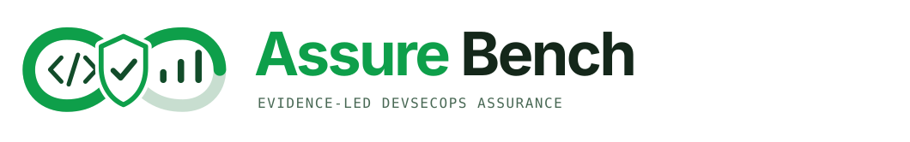

# AssureBench

<p align="center">
  
</p>

```text
  .-----------------------------------------.
  |  ZIP IN  ->  SCAN EVIDENCE  ->  REPORT  |
  '-----------------------------------------'
```

**Local-first DevSecOps security assurance workbench**

AssureBench turns a GitHub source ZIP into an evidence-led security assessment: findings, dependency and CVE tracking, SBOM, source-derived application topology, STRIDE threat hypotheses, scan-stage outcomes, framework mappings, and a printable report. It is designed to inspect untrusted source without running the uploaded project's code.

The current release focuses on static repository analysis. DAST and ISAT are future capability areas, not features of this release.

## Quick start

### Requirements

- Python 3.9 or newer.
- Docker Engine available on the local machine, with permission to run containers. OrbStack works on macOS.
- Outbound network access so Docker can pull pinned scanner images and scanners can obtain rules/advisory data.
- For the dashboard, a ZIP archive of the repository to assess (up to 100 MiB).
- For CLI scans, a local repository directory (up to 500 MiB of included files).

No Python packages or Node.js packages need to be installed.

### Run

```bash
cd AssureBench
python3 secassure.py --dashboard
```

Open [http://127.0.0.1:8765/](http://127.0.0.1:8765/) and:

1. Get a ZIP archive of the source repository. On GitHub, open the repository, select **Code**, then **Download ZIP**. Do not upload credentials or files you do not want included in an assessment.
2. Select the ZIP file in AssureBench. The dashboard checks archive paths, links, size, and compression before extracting it.
3. Review the detected project name, file inventory, and architecture preview. Select **Analyze Repository** to start the scan, and keep the page open until it finishes.
4. Review the summary, findings, package advisories, architecture, threat scenarios, and stage-by-stage results. A skipped or failed stage means that check did not complete; it is not a clean result.
5. Save the assessment before closing or restarting the dashboard. Select **Export PDF** and choose **Save as PDF**, or use **Copy Report** for Markdown.

AssureBench analyzes source and configuration files. It does not install dependencies or run the uploaded project's build, test, or application commands.

Stop the controller with **Ctrl-C** in its terminal. The controller binds to loopback only; do not expose it through a reverse proxy or bind it to a public interface.

### Run in Docker or OrbStack

From the AssureBench directory, build and start the dashboard container. Docker assigns an available host port on loopback, and the script prints the URL to open:

```bash
sh start-compose.sh
```

The container listens on port 8765 internally. The host port is selected by Docker and may differ between runs; `start-compose.sh` prints the exact `http://127.0.0.1:<port>/` address after startup. Compose publishes the web port only on host loopback, so it is available on this machine and not to other machines on the network. The named work volume is created automatically. Follow startup and scan logs with:

```bash
docker compose logs -f
docker compose down
```

No `.env` file or user-supplied environment variables are required. The named `assurebench-work` Docker volume stores temporary scan inputs and outputs between runs; reports remain in controller memory and are lost when it restarts. The Compose service uses the local Docker socket to launch scanner containers, so it can control that Docker engine. Uploaded project code is not executed, and scanner containers use constrained settings, but the Docker socket means this is not a strong boundary against a compromised dashboard. For untrusted multi-user use, run it against a dedicated isolated Docker engine.

### Run the CLI in a container

This works on any host with Docker Compose v2. The project directory is mounted read-only into the AssureBench CLI container. AssureBench makes a bounded private copy in the `assurebench-work` volume; scanner containers receive only that copied workspace as a read-only mount. The original directory is never mounted into a scanner or modified, and project commands are not run.

The controller receives the local Docker socket to launch scanners. Treat it as trusted single-user tooling, not as a hostile multi-tenant security boundary.

From the AssureBench directory, run the command below. Replace the two example host paths with absolute paths to the repository to scan and an existing directory for the report. Use the path syntax supported by your Docker host:

```bash
docker compose run --build --rm \
  --volume "/absolute/path/to/repository:/input:ro" \
  assurebench \
  python3 secassure.py --container /input > assessment.md
```

The scan progress appears in the terminal, and the final Markdown report is written to `assessment.md` in the current host directory. Add `--verbose` before `--container` to stream scanner output as well. To print the Markdown report in the terminal instead, omit `> assessment.md`.

For a native CLI invocation, install Python 3.9 or newer and use the Docker-compatible engine available on that host:

```bash
python3 secassure.py /path/to/repository --output assessment.md
```

The native CLI follows the same source-copy and scanner-container safeguards.

The CLI leaves the selected repository unchanged. It prepares a private temporary copy, excludes common generated/vendor directories (`.git`, `node_modules`, `vendor`, build output, and language caches), rejects symbolic links and special files, and removes its temporary copy after the run. It applies a 500 MiB expanded-size and 20,000-file limit. The report is the only content written to stdout; progress and errors go to stderr. A failed scan still emits its stage-complete Markdown report and exits non-zero.

Show CLI options with:

```bash
python3 secassure.py --help
```

The CLI and dashboard use the same digest-pinned scanners. Neither mode needs an `.env` file or user-supplied environment variables. In container mode, the named work volume is used to transfer the private scan copy and temporary scanner output between the controller and scanner containers; temporary run data is removed after report generation. A small root-owned entrypoint reads the mounted socket's numeric group ID, then drops privileges and starts the controller as UID 10001 with that socket group and the work-volume group. This supports Docker Engine hosts whose socket group is not 0 without changing socket permissions. A one-shot volume initializer prepares the named work volume for that UID; it has no Docker socket, network, or Linux capabilities beyond changing the mounted volume's ownership. The app container starts with only the SETUID and SETGID capabilities needed by the entrypoint to drop privileges; the controller runs without those capabilities. The container health check requests the local bootstrap endpoint without starting a scan.

## What is included

- **Static analysis:** Semgrep source analysis, Trivy dependency/IaC/secret checks, and Checkov infrastructure-as-code checks.
- **Supply-chain inventory:** Syft CycloneDX SBOM and dependency relationships, with Grype as an independent advisory cross-check.
- **Repository hygiene:** actionlint for GitHub Actions workflows and ShellCheck for shell scripts.
- **Architecture evidence:** a portrait service-path diagram, inferred trust zones, interfaces, flows, and data mappings based on uploaded source and configuration.
- **Finding traceability:** severity markers on mapped architecture components, detailed finding explanations, remediation and validation guidance, and a package → advisory → reported package/file location tree.
- **Threat modelling:** six STRIDE threat hypotheses and up to three severity-ranked finding scenarios, with conditional MITRE ATT&CK technique references.
- **Assessment record:** all configured stages, their purpose, outcome, and execution detail or skip/failure reason; OWASP Top 10, NIST CSF, SSDF, and OWASP SAMM evidence mappings; references and a UUID-bound report-integrity digest.
- **PDF report:** AssureBench-branded cover and logo, portrait topology pages, compact portrait tables where they fit, and A3 landscape pages for wide tables.

## Assessment limits

This is a static source assessment, not a penetration test, live deployment review, compliance certification, or proof that a repository is secure. It does not verify runtime reachability, deployed cloud controls, authentication and authorization behavior, organizational processes, or vulnerable source call sites unless a scanner explicitly reports them. STRIDE entries and ATT&CK techniques are evidence-led hypotheses and candidates, not confirmed attack paths.

Package manifests and SBOM locations identify where a package was detected. They do not by themselves prove that vulnerable code is called. Validate applicability, the deployed version, affected feature, reachability, and available mitigations before accepting or closing a finding.

## Safety and data handling

- ZIP entries are validated before extraction. The upload and expanded archive have size, entry-count, depth, path, link, encryption, and compression-ratio limits.
- Extracted source is stored in a private temporary directory and mounted read-only into pinned scanner containers. Containers are removed after each stage; temporary source and scanner outputs are removed after report generation.
- CLI inputs are copied into a private temporary workspace first; the original local directory is mounted neither writable nor directly into a scanner.
- The uploaded repository's install, build, test, and application commands are **never executed**.
- Scanner containers have network access when required for rules and vulnerability data. Syft and selected offline validation stages run without network access.
- Reports and run state stay in controller memory while the process is running. Save the report before stopping or restarting the controller.
- Docker scanner images remain in Docker's local image cache after a run.

## Repository layout

```text
AssureBench/
├── server.py              # Loopback HTTP controller, ZIP validation, scan orchestration, reports
├── secassure.py           # CLI: scan current/local directory and emit Markdown
├── index.html             # Dashboard and report structure
├── app.js                 # Upload flow and interactive report rendering
├── styles.css             # Dashboard, topology, and print/PDF layout
├── assets/
│   └── brand/              # Supplied AssureBench SVG wordmarks and favicon
├── tests/
│   └── test_server.py     # Parser, archive, report, topology, and API regression tests
├── docs/
│   └── ARCHITECTURE.md    # Components, data flow, trust boundaries, and extension direction
├── .gitignore
└── README.md
```

## Development and tests

Run the regression suite from the repository root:

```bash
python3 -m unittest discover -s tests -v
```

The server uses Python's standard library. The test suite does not require Docker; running an end-to-end scan does.

## Report interpretation

Read the report's **Scope and interpretation** and **Coverage boundary** before acting on results. For each finding, verify the affected file, package or infrastructure resource, whether the vulnerable behavior is enabled and reachable, and whether the recommended fixed version is appropriate. A skipped stage is not a clean result: use its recorded reason to determine what coverage is missing.

See [docs/ARCHITECTURE.md](docs/ARCHITECTURE.md) for the component and data-flow description.
