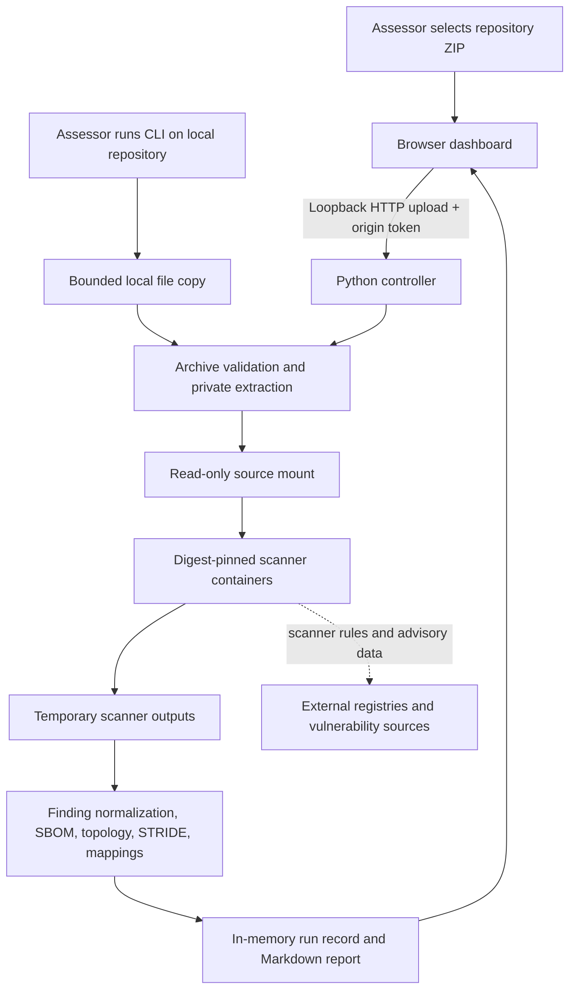

# AssureBench architecture

AssureBench is a local-first assessment workbench. Its dashboard and controller run on the assessor's machine; the repository being assessed is supplied as an archive and is not executed as an application.

## Components and data flow

### Browser dashboard

`index.html`, `app.js`, and `styles.css` provide the upload flow, scan-stage progress, topology preview, findings, package inventory, threat scenarios, and print-to-PDF view. The dashboard and PDF cover use the supplied dark/light AssureBench SVG wordmarks in `assets/brand/`; the favicon is served from the same asset directory. The browser sends requests only to the same-origin local controller. It does not receive shell commands, scanner image names, or extraction paths from the user.

### Python controller

`server.py` uses Python's standard library for the HTTP server, archive validation, report generation, and scan orchestration. `secassure.py` is the user-facing CLI entry point. The native dashboard binds to `127.0.0.1:8765`; the Compose dashboard listens on port 8765 inside its container and Docker assigns an available host port on `127.0.0.1`. The startup script prints the selected URL. The dashboard checks the request host and matching origin, and requires a per-process token for upload/run actions. The scanner's repository root is the directory containing `server.py`; it does not inspect the parent directory.

The controller accepts ZIP uploads up to 100 MiB and validates entries before extraction. It rejects traversal paths, absolute paths, links and special files, encrypted entries, excessive expanded size or entry count, excessive nesting, and high compression ratios. Extracted files are placed in a private temporary directory. Scan records and generated report text are kept in memory and are lost when the controller exits.

The CLI accepts a local directory instead of an archive. It copies regular files into a bounded temporary ZIP, excludes common generated/vendor directories, rejects symbolic links and special files, and passes the result through the same archive validation and scan manager. In container mode (`secassure.py --container`), the project is mounted read-only into the controller, copied to the named private work volume, then each scanner mounts only its per-run copy read-only. The original project directory is not mounted into scanner containers or modified. Markdown goes to stdout (or the selected output file); progress and diagnostics go to stderr.

### Scanner containers

The controller checks that Docker is available, ensures scanner images pinned by immutable digest are present, then runs supported stages against the extracted repository. The source is mounted read-only. Containers drop Linux capabilities, disallow privilege escalation, and have process, memory, and CPU limits. Syft and selected validation tools run without network access; other scanner stages use network access where required for rules or vulnerability data. Each stage container is removed after use. Cached images remain in Docker.

In Compose, the dashboard container talks to the Docker socket provided by the local Docker-compatible engine. Scanner inputs and outputs use a named Docker volume and each scanner mounts only its run-specific subdirectory. Compose publishes the dashboard only on host loopback. The Docker socket is a powerful host capability: a compromised dashboard process could control the local engine and launch other containers. Container hardening and not executing uploaded project code reduce exposure, but this setup is not an isolation boundary against a compromised controller. Use a dedicated VM/engine for untrusted multi-user access.

The uploaded project's package manager, build, test, deployment, and application commands are not run. A configured build/test stage is deliberately recorded as skipped with that explanation rather than being marked completed.

## Assessment pipeline

The ordered stage ledger in every report covers:

1. Archive and Docker preflight.
2. Pull/availability check for digest-pinned scanner images.
3. Semgrep source analysis.
4. Trivy dependency, IaC, and secret scan.
5. Checkov IaC checks and duplicate IaC finding cleanup.
6. Syft CycloneDX SBOM generation.
7. Grype SBOM advisory cross-check when an SBOM is available.
8. actionlint when GitHub Actions workflow files exist.
9. ShellCheck when shell scripts exist.
10. Project build/test commands, intentionally skipped.
11. Report generation, including topology, threat model, and framework evidence mapping.

Conditional stages include explicit skip reasons. If a fatal stage stops execution, the active stage and queued stages are marked failed/skipped with the cause.

## Data lifecycle and trust boundaries

| Boundary | Data and control |
|---|---|
| Assessor → browser | A local ZIP selected by the assessor; browser enforces the 100 MiB limit before upload. |
| Browser → controller | Same-origin loopback request protected by host/origin validation and a controller token. |
| Controller → temporary workspace | Validated archive contents only; private temporary directory; deleted after report generation or failure cleanup. |
| Workspace → container | Read-only source bind mount; scanner output uses a separate temporary mount. |
| Container → external services | Network is available only where a scanner needs rules, image downloads, or vulnerability data; uploaded source is not intentionally sent to scanner services. |
| Controller → browser | Normalized findings, stage statuses, topology and generated report; run state remains in controller memory. |

This is a defense-in-depth design, not a guarantee that an untrusted archive or scanner defect is harmless. Docker access is privileged on many machines. Use a disposable or appropriately isolated workstation for repositories of unknown provenance. Do not expose the loopback service through a reverse proxy or tunnel.

## Report generation

Scanner output parsers normalize findings into a common record. The report combines these records with package metadata from the SBOM, source-derived topology, six STRIDE threat hypotheses, conditional ATT&CK candidates, scan-stage details, and evidence-only framework mappings. A SHA-256 digest binds the report content to its scan UUID; it is an integrity fingerprint, not a digital signature or identity attestation.

The HTML and Markdown report describe the same assessment. Print CSS keeps the cover and topology in portrait format, uses portrait pages for compact tables, and selects A3 landscape for wide tables. Browser print settings can override CSS page sizes; enable background graphics if the branded cover background is desired.

## Extension direction

The initial product is a static repository assessment workbench. DAST and ISAT are future capability areas, not implemented stages. Adding them should preserve the explicit stage ledger, evidence provenance, authorization boundaries, and distinction between source-derived inference and verified runtime behavior. Dynamic testing will require an explicitly authorized target and a separately designed isolation/safety model; it must not silently turn ZIP uploads into executable projects.
